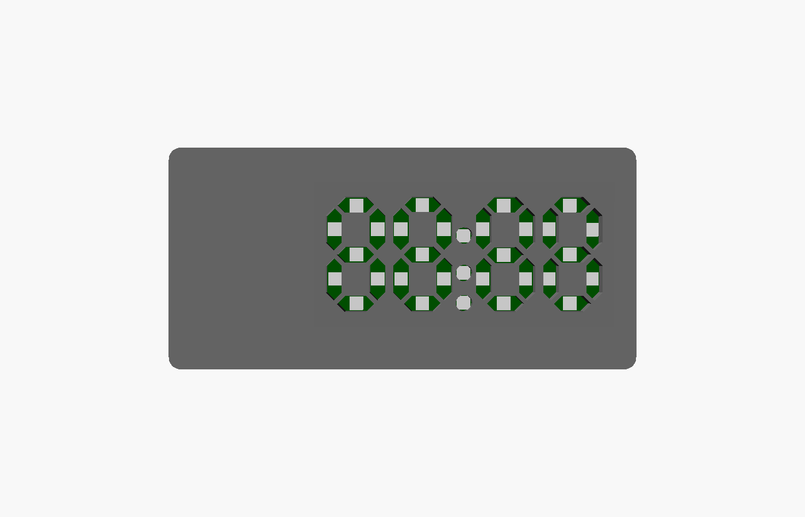
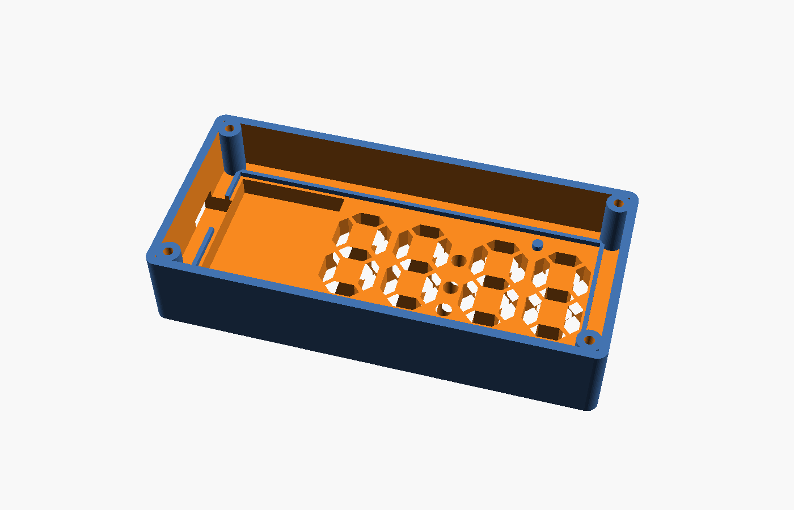
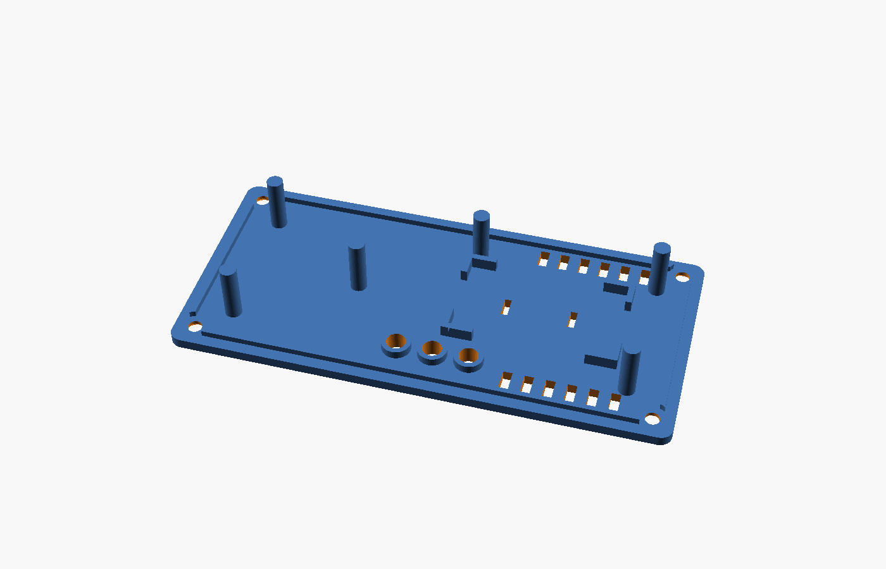

# Clauck housing (draft v0.1)

Parametric OpenSCAD enclosure for the `NG_WPI_7seg_PCB` clock board. All the
board geometry (outline, LED positions, USB, buttons, the single M3 hole) is
taken from `hardware/pcb/source (kicad files)/NG_WPI_7seg_PCB.kicad_pcb`.



## What it is

A 3D-printed desk block, **118 × 56 × 25 mm**, in three printed parts:

| Part | File | Print |
|---|---|---|
| Front shell with the segment light-guide grid | `stl/front.stl` | face down, no supports |
| Back plate with clamp posts, vents and the DS3231 cradle | `stl/back.stl` | outside face down |
| Button plunger | `stl/plunger.stl` | print 3, standing on the cap |

Plus 4 × M3 × 16 countersunk self-tapping screws (or M3 heat-set inserts:
set `SCREW_D = 4.0`) and a diffuser sheet.

### How it goes together

1. The PCB drops into the front shell face down. A pin goes through the
   board's only M3 hole and a 1.6 mm rim locates the edges.
2. Each LED sits in its own hexagonal cell (classic 7-segment shape), 7 mm deep,
   so segments stay crisp and don't bleed into each other.
3. Put the 3 plungers through the back plate from the inside (their flange
   keeps them in), lay the DS3231 module in its cradle, then screw the back on.
   Six posts on the back plate press the PCB flat against the grid.
4. Micro USB plugs in through a tunnel in the left side.

The buttons are on the back of the board, so you press them from behind.
Seen from the back, SW3 is on the left and SW1 on the right.

### Front face options (`FACE_MODE`)

- `"inset"` (default): open segment cells, plus a 1 mm pocket on the front for a
  diffuser sheet (frosted or smoked acrylic, or a few layers of tracing paper).
- `"skin"`: cells are closed by a 0.6 mm skin. Print the first 2–3 layers in
  white or natural PLA, then switch to black. No separate diffuser needed.
- `"open"`: bare segment holes.

## Things worth knowing

- **Headers:** J1/J2/J3 are assumed unpopulated. The electronics pocket behind
  the left bezel is 5.8 mm deep: enough for C1 (the 5.3 mm electrolytic) and the
  USB jack, not for pin headers.
- **Heat / safety:** there are vent slots top and bottom on the back. After the
  board that burned, a PTC fuse across JP1 fits on the board itself, so the case
  needs no extra space for it.
- **Fit:** `CLR` (0.3 mm) is the general clearance. Print a test of the front
  shell first and adjust `CLR`, `SEG_W` or `SEG_GAP` if the grid hits an LED.

## Rendering

```
openscad -o stl/front.stl -D 'part="front"' clock_housing.scad
openscad -o stl/back.stl  -D 'part="back"'  clock_housing.scad
openscad -o stl/plunger.stl -D 'part="plunger"' clock_housing.scad
```

`part="assembly"` shows everything stacked with a ghost PCB, and
`part="section"` cuts through SW1 and digit 1 to check the stack-up.

| Inside of the front shell | Back plate (inside) |
|---|---|
|  |  |
